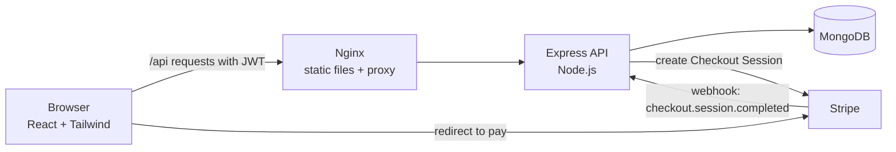

# ShopLite — Full-Stack E-commerce Store

A small but complete online store: browse and search products, manage a cart, pay with **Stripe Checkout (test mode)** and track orders. Admins get an inventory panel to add, edit and delete products.

Built with **Node.js, Express, MongoDB and React**, with JWT authentication, role-based access, request validation, automated tests, Docker and GitHub Actions CI.


---

## Features

**Shopping**
- Product catalogue with **text search**, **category** and **price-range filters**, **sorting** and **pagination** (filters are kept in the URL, so results are shareable)
- Product detail page with stock status
- Server-side cart that follows the user across devices, with stock checks
- Checkout through **Stripe Checkout**; a webhook marks the order as paid, reduces stock and empties the cart
- Order history and order detail pages

**Admin**
- Inventory page to create, edit and delete products (low-stock items are highlighted)
- Admin-only endpoints to list all orders and change order status (`pending → paid → shipped`)

**Engineering**
- JWT authentication with `user` and `admin` roles (users can't promote themselves at sign-up)
- Input validation with `express-validator` and a central error handler that returns clean JSON errors
- Passwords hashed with bcrypt and never returned by the API
- Order items store the price at purchase time, so catalogue changes don't rewrite history
- Jest + Supertest API tests, Dockerfiles, Docker Compose and a GitHub Actions pipeline

## Architecture



**Checkout flow**

1. The client calls `POST /api/orders/checkout`.
2. The API checks stock, creates a `pending` order from the cart and creates a Stripe Checkout Session.
3. The browser is redirected to Stripe's hosted payment page.
4. After payment Stripe calls `POST /api/webhooks/stripe`. The API verifies the signature, marks the order `paid`, reduces stock and clears the cart.

> **No Stripe keys?** Leave `STRIPE_SECRET_KEY` empty and checkout is *simulated*: the order is marked paid immediately so you can try the full flow locally.

## Getting started

### Option 1: Docker (recommended)

```bash
git clone https://github.com/shaziadev/shoplite.git
cd shoplite
cp server/.env.example server/.env
docker compose up --build
# In another terminal, load sample products and demo accounts:
docker compose exec server node src/utils/seed.js
```

Open **http://localhost:3000**.

### Option 2: Run locally

Requires Node.js 22+ and a MongoDB instance (local or MongoDB Atlas).

```bash
# API
cd server
cp .env.example .env      # set MONGO_URI and JWT_SECRET
npm install
npm run seed              # sample products + demo users
npm run dev               # http://localhost:5000

# Client (new terminal)
cd client
npm install
npm run dev               # http://localhost:5173 (proxies /api to :5000)
```

### Demo accounts (after seeding)

| Role  | Email               | Password |
|-------|---------------------|----------|
| Admin | admin@shoplite.dev  | admin123 |
| User  | user@shoplite.dev   | user123  |

### Paying with Stripe test mode

1. Put your **test** secret key (`sk_test_...`) in `server/.env` as `STRIPE_SECRET_KEY`.
2. Forward webhooks with the [Stripe CLI](https://stripe.com/docs/stripe-cli):
   ```bash
   stripe listen --forward-to localhost:5000/api/webhooks/stripe
   ```
   Copy the `whsec_...` value it prints into `STRIPE_WEBHOOK_SECRET`.
3. At checkout, use the test card **4242 4242 4242 4242**, any future expiry date and any CVC.

No real money is charged in test mode.

## API reference

Base URL: `/api`. Send `Authorization: Bearer <token>` for protected routes.

| Method | Endpoint | Access | Description |
|--------|----------|--------|-------------|
| GET | `/health` | Public | Health check (also shows whether Stripe is live or simulated) |
| POST | `/auth/register` | Public | Create an account → `{ user, token }` |
| POST | `/auth/login` | Public | Log in → `{ user, token }` |
| GET | `/auth/me` | User | Current user |
| GET | `/products` | Public | List products. Query: `search`, `category`, `minPrice`, `maxPrice`, `sort` (`newest`, `price_asc`, `price_desc`, `name`), `page`, `limit` |
| GET | `/products/categories` | Public | All categories |
| GET | `/products/:id` | Public | Product details |
| POST | `/products` | Admin | Create product |
| PUT | `/products/:id` | Admin | Update product |
| DELETE | `/products/:id` | Admin | Delete product |
| GET | `/cart` | User | Get cart with total |
| POST | `/cart` | User | Add item `{ productId, quantity }` |
| PATCH | `/cart/:productId` | User | Set quantity `{ quantity }` |
| DELETE | `/cart/:productId` | User | Remove item |
| DELETE | `/cart` | User | Empty cart |
| POST | `/orders/checkout` | User | Create order and Stripe session → `{ orderId, url }` |
| GET | `/orders/mine` | User | My orders |
| GET | `/orders/:id` | Owner / Admin | Order details |
| GET | `/orders` | Admin | All orders |
| PATCH | `/orders/:id/status` | Admin | Update status `{ status }` |
| POST | `/webhooks/stripe` | Stripe | Payment webhook (signature verified) |

Example:

```bash
curl "http://localhost:5000/api/products?search=mug&category=home&sort=price_asc&page=1&limit=12"
```

Errors always look like:

```json
{ "message": "Validation failed", "details": [{ "field": "email", "message": "A valid email is required" }] }
```

## Tests

```bash
cd server
npm test
```

The suite uses **Jest** and **Supertest** to call the real Express app and covers:

- auth: register, login, `/me`, duplicate emails, wrong passwords, role can't be set at sign-up
- products: pagination, category and price filters, text search, sorting, admin-only create/update/delete, validation
- cart: add, update, remove, stock limits
- orders: empty-cart checkout, simulated payment (order paid, stock reduced, cart cleared), order ownership, admin status updates

Tests use an in-memory MongoDB ([mongodb-memory-server](https://github.com/typegoose/mongodb-memory-server)) by default, or a real database when `MONGO_URI_TEST` is set (this is what CI does).

## CI/CD

`.github/workflows/ci.yml` runs on every push and pull request to `main`:

- **server-tests**: installs dependencies and runs the Jest suite against a MongoDB 7 service container
- **client-build**: installs dependencies and builds the React app with Vite

## Project structure

```
shoplite/
├── client/                   # React (Vite) + Tailwind CSS
│   ├── src/
│   │   ├── api/client.js     # fetch wrapper (JWT header, error handling)
│   │   ├── context/          # AuthContext, CartContext
│   │   ├── components/       # Navbar, ProductCard, Pagination, ProtectedRoute...
│   │   └── pages/            # Products, ProductDetail, Cart, Orders, Admin, Login...
│   ├── Dockerfile            # multi-stage build → Nginx
│   └── nginx.conf
├── server/                   # Express REST API
│   ├── src/
│   │   ├── config/           # env + database connection
│   │   ├── models/           # User, Product, Cart, Order (Mongoose)
│   │   ├── controllers/      # request handlers
│   │   ├── routes/           # routes + validation rules
│   │   ├── middleware/       # auth (JWT, roles), validation, errors
│   │   ├── services/         # Stripe client, order fulfilment
│   │   ├── utils/            # seed script, token helper, ApiError
│   │   ├── app.js            # Express app (exported for tests)
│   │   └── server.js         # connects to MongoDB and starts the app
│   ├── tests/                # Jest + Supertest
│   └── Dockerfile
├── docker-compose.yml        # mongo + server + client
└── .github/workflows/ci.yml
```

## What I'd add next

- Product image uploads to S3 / Cloudinary
- Refresh tokens and password reset by email
- Product reviews and ratings
- Order confirmation emails
- End-to-end tests with Playwright

## License

[MIT](LICENSE) © 2026 Shazia Abbas
